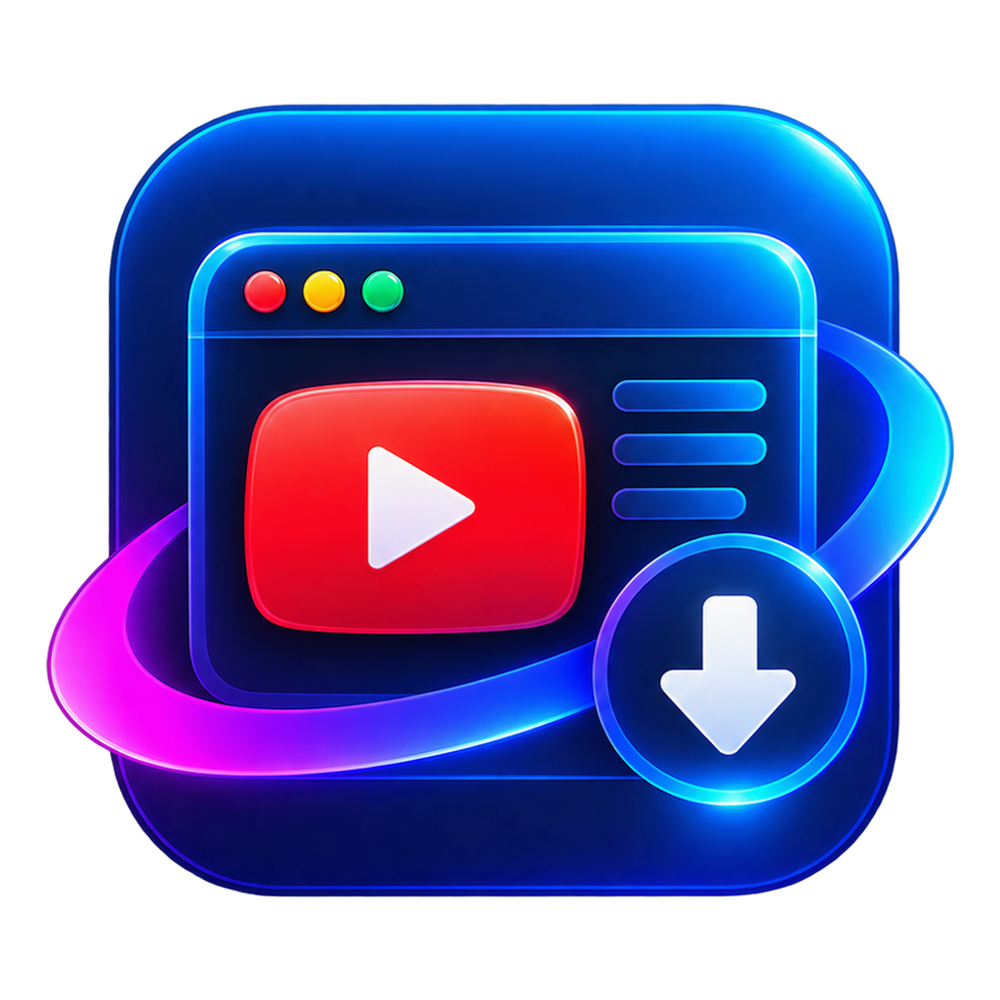

# 🚀 BroTube

> **A modern, ad-free desktop YouTube client & lossless 4K/8K media studio built on Electron, iOS / visionOS Liquid Glassmorphism, and yt-dlp.**



---

## ✨ Features

- 🛡️ **Brave-Parity Ad Defuser**: Complete zero-ad experience. Eliminates prerolls, midrolls, overlay cards, and anti-adblock detection banners through Blink-native CSS injection and universal `JSON.parse` player data filtering.
- ⚡ **Lossless 4K/8K DASH Media Downloader**: Uses `yt-dlp` and **Gyan FFmpeg 9.0.1 Essentials** to mux the highest quality video and audio streams without lossy re-encoding (Peak 8K/4K HDR, 1440p, 1080p60, 720p, or lossless audio extractions: FLAC, MP3 320k, Opus).
- 📂 **Smart Folder Organization**: Videos are automatically saved to `Videos/BroTube/videos/`, audios to `Videos/BroTube/audios/`.
- 📑 **Playlist Batch Downloads**: Supports downloading entire playlists with subfolder sorting (`videos/<playlist_title>/01 - Title.mkv`), live real-time track progress reporting (`[Track X/Y] Video Title`), and dynamic percentage/speed/ETA telemetry.
- 🎨 **iOS & visionOS Liquid Glass UI**: 3-layer design token system with Apple SF Pro typography, authentic visionOS blur depths (`42px` to `54px`), specular rim light insets, calibrated transparency (`0.44`–`0.56`), and high-contrast deep ink text in light mode.
- 🌓 **Dynamic Webpage Theme Synchronization**: Switching between Light and Dark mode changes both the application HUD and YouTube's internal player theme in real-time via live DOM attribute updates and `PREF` session cookie synchronization.
- 🔗 **Native Share & External Protocol Integration**: Clicking WhatsApp, Email, Twitter/X, or Facebook from YouTube's share drawer seamlessly triggers native OS protocols (`whatsapp:`, `mailto:`, web intents) in external desktop apps or default browser via `shell.openExternal`.
- 🛡️ **Process Safety on Close (Window Close Guard)**: Intercepts accidental window closures during active downloads or conversions, displaying a spatial liquid glass confirmation modal with "Cancel" and "Quit Anyway" safety actions.
- 🎬 **Dynamic Shorts Redirection**: Toggle between standard Shorts feed mode and full desktop player mode (`/watch?v=<id>`) with standard playback controls, scrubber, and speed settings.
- 🪟 **Windows 11 Fluent Frame Integration**: Frameless window chrome with 1px specular rim border, 10px rounded corners, responsive window controls with red close hover states, and automatic flush edge snapping when maximized.
- ✨ **Kinetic Typography Entrance**: Opening screen features the static neon logo with a floating breathing pulse and kinetic spring-settle typography using Google Fonts **Outfit** and **Plus Jakarta Sans**.
- 🔊 **300% Volume Booster**: WebAudio Gain Node with dynamics compressor limiter to amplify quiet videos up to 300% without distortion.
- 🖼️ **Native Floating Picture-in-Picture**: Seamlessly detaches video into OS-level floating player.
- 🔐 **Native Google Session Auth**: Log into your Google / YouTube account directly within the sandboxed profile; cookies are automatically synchronized for members-only, 1080p Premium, and age-restricted downloads.

---

## 🛠️ Tech Stack & Architecture

- **Desktop Shell**: Electron 44, Node.js 24, Chromium
- **Media Engine**: `python -m yt_dlp` (2026.08.19+), Gyan FFmpeg 9.0.1 Essentials
- **UI Architecture**: Vanilla HTML5, CSS3 Custom Properties (iOS Liquid Glass 3-Layer Tokens), Spatial Glassmorphism
- **Typography**: Apple SF Pro Stack, Outfit (wght 400–900), Plus Jakarta Sans (wght 400–800)
- **Lifecycle Tracking**: Obsidian Vault (`BroTube_Vault/`)

---

## 🚀 Getting Started

### Prerequisites

- **Node.js** v24+
- **Python** 3.12+ with `yt-dlp` installed (`pip install -U yt-dlp`)
- **FFmpeg** 7.0+ (Gyan FFmpeg Essentials recommended in PATH)

### Installation

```bash
git clone https://github.com/user/BroTube.git
cd BroTube
npm install
```

### Running the App

```bash
npm start
```
Or launch via the Windows script:
```cmd
Launch-BroTube.bat
```

### Running Self-Check Tests

BroTube includes a comprehensive zero-dependency assertion test suite:
```bash
npm test
```

---

## ⌨️ Keyboard Shortcuts & Gestures

| Shortcut / Gesture | Action |
| :--- | :--- |
| `Ctrl + D` | Open Lossless Download Studio Modal |
| `Ctrl + J` | Toggle Downloads Hub Drawer |
| `Escape` | Dismiss modal, drawer, or settings popover |
| `Double-Click Header` | Toggle Maximize / Restore Window |
| `Mouse Button 4 / 5` | Browser Back / Forward Navigation |
| `Click / Space / Esc` | Skip Intro Opening Screen |

---

## 📚 Project Lifecycle Documentation

Comprehensive project architecture, adblocking mechanisms, and development logs are tracked inside the Obsidian vault:
- [`BroTube_Vault/BroTube.md`](BroTube_Vault/BroTube.md) — Master Hub
- [`BroTube_Vault/01 - Architecture & Design.md`](BroTube_Vault/01%20-%20Architecture%20&%20Design.md)
- [`BroTube_Vault/02 - Session Log & Progress.md`](BroTube_Vault/02%20-%20Session%20Log%20&%20Progress.md)
- [`BroTube_Vault/03 - YouTube Anti-Breakage & Adblock.md`](BroTube_Vault/03%20-%20YouTube%20Anti-Breakage%20&%20Adblock.md)
- [`BroTube_Vault/04 - Media Download Pipeline.md`](BroTube_Vault/04%20-%20Media%20Download%20Pipeline.md)
