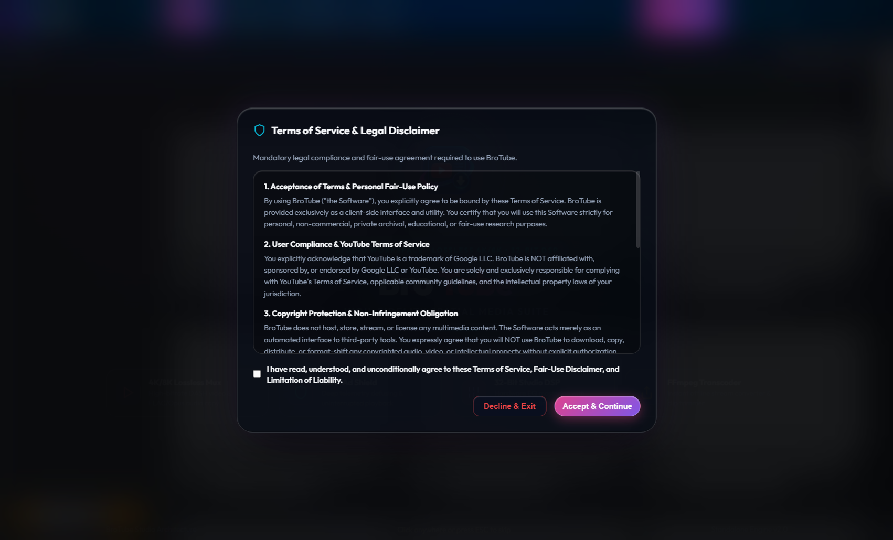
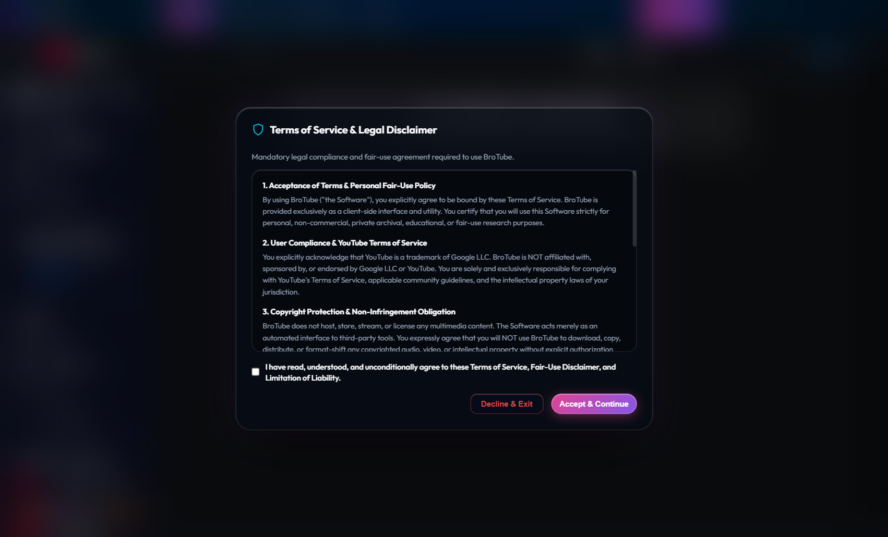
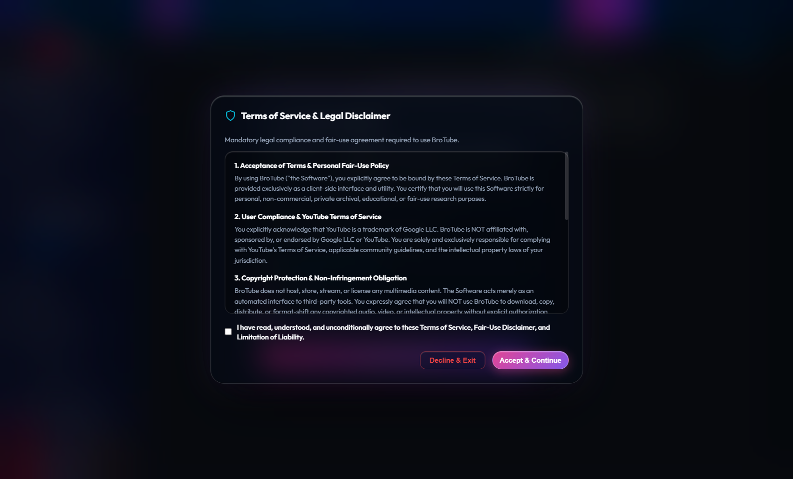
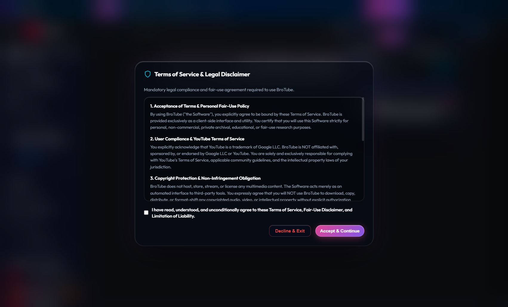
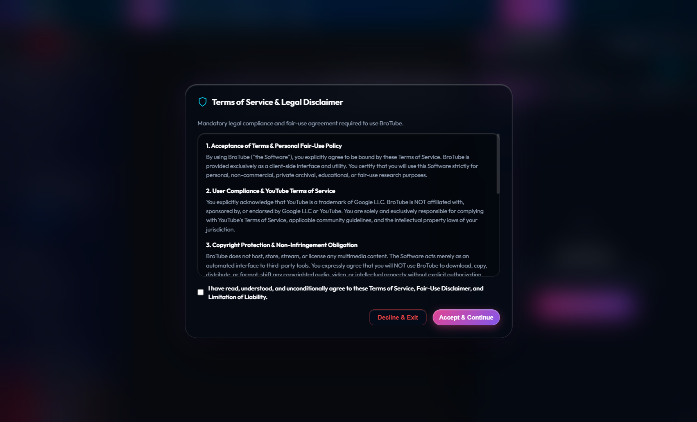
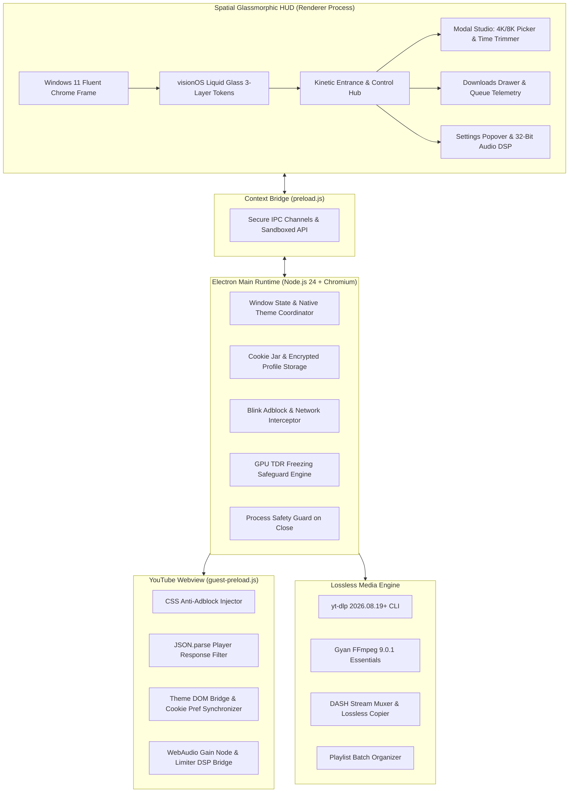

<div align="center">

  

  # 🚀 BroTube

  ### Spatial Glassmorphic Ad-Free YouTube Desktop Client & Lossless 4K/8K Media Studio

  <p align="center">
    <b>A high-fidelity Windows desktop experience powered by Electron 44, Chromium, visionOS Liquid Glass design tokens, and a resilient yt-dlp & FFmpeg 9.0.1 DASH media engine.</b>
  </p>

  [](LICENSE)
  [](https://www.electronjs.org/)
  [](https://nodejs.org/)
  [](https://www.microsoft.com/windows)
  [](CONTRIBUTING.md)

  <p align="center">
    <a href="#-key-features">Features</a> •
    <a href="#-visual-tour">Visual Tour</a> •
    <a href="#-architecture">Architecture</a> •
    <a href="#-installation--setup">Installation</a> •
    <a href="#-keyboard-shortcuts">Shortcuts</a> •
    <a href="#-building-installer">Build Release</a> •
    <a href="#-documentation">Docs</a> •
    <a href="#-disclaimer">Disclaimer</a>
  </p>

</div>

---

## 📖 Overview

**BroTube** is engineered to restore freedom, performance, and aesthetic luxury to YouTube on the desktop. It marries a **Brave-parity network and DOM ad-defuser** with an Apple **visionOS / iOS liquid glass design system**, combined with a **lossless 4K/8K DASH media extraction and conversion studio**.

Say goodbye to unskippable mid-rolls, anti-adblock nagging modals, bloated memory consumption, and sketchy browser downloader extensions. BroTube delivers a native, sandboxed, high-performance streaming environment with built-in 300% WebAudio gain mastering, picture-in-picture, and real-time light/dark theme synchronization.

---

## 📸 Visual Tour

<div align="center">

### 🌟 Kinetic Typography & Splash Entrance
*Kinetic spring-settle typography with ambient orbital neon glow and diagnostic telemetry bar.*
<br/><br/>


<br/><br/>

### 🖥️ Spatial visionOS Liquid Glass Interface
*Frameless Windows 11 Fluent chrome with 1px specular rim light, Apple SF Pro typography, and YouTube DOM integration.*
<br/><br/>


<br/><br/>

### ⚡ Lossless 4K/8K Media Download Studio
*Direct DASH stream extraction (Peak 8K/4K HDR, 1080p60, Lossless FLAC/Opus) with time-range trimming and playlist batching.*
<br/><br/>


<br/><br/>

### 🎛️ 32-Bit Studio DSP & Settings Hub
*WebAudio hardware equalizer with dynamic peak limiter, 300% volume booster, cookie synchronization, and shield controls.*
<br/><br/>


<br/><br/>

### 📂 Slide-out Downloads Hub & Telemetry Queue
*Real-time download telemetry, multi-stream progress bars, destination path routing, and playlist tracker.*
<br/><br/>


</div>

---

## ✨ Key Features

### 🛡️ Brave-Parity Ad Defuser
- **Zero-Ad Experience**: Blocks prerolls, midrolls, sponsor teasers, overlay cards, and anti-adblock detection banners.
- **Deep Telemetry Defusing**: Blink-native CSS stylesheet injection combined with universal `JSON.parse` player response sanitization.
- **Anti-Adblock Evasion**: Strips YouTube anti-adblock telemetry beacons and warning popups before scripts execute.

### ⚡ Lossless 4K/8K Media Download Studio
- **Raw DASH Stream Muxing**: Direct copy of highest bitrate VP9/AV1 video streams and Opus/AAC audio streams without lossy re-encoding via **yt-dlp** and **Gyan FFmpeg 9.0.1 Essentials**.
- **Supported Formats**: 8K 4320p HDR, 4K 2160p UHD, 1440p QHD, 1080p60 Full HD, 720p, or Lossless Audio (FLAC, MP3 320k, Opus, WAV).
- **Time-Range Video Trimmer**: Clip and export exact video/audio segments (`HH:MM:SS` start/end timestamps).
- **Smart Playlist Batching**: Downloads complete playlists into organized subfolders (`videos/<Playlist Name>/01 - Title.mkv`) with live `[Track X/Y]` telemetry.
- **Direct 1-Click Mode**: Remembers your preferred quality preset to download immediately with one click.

### 🎨 iOS & visionOS Liquid Glass UI
- **3-Layer Design Token System**: Primitives $\rightarrow$ Semantic Tokens (Dark & Light) $\rightarrow$ Component Specifications.
- **Authentic visionOS Glass**: Multi-stage backdrop blur (`42px` to `54px`), specular rim light insets (`1px solid rgba(255, 255, 255, 0.14)`), and calibrated opacity (`0.44`–`0.56`).
- **Apple SF Pro & Google Outfit Typography**: Deep ink typography in light mode and luminescent neon accents in dark mode.

### 🔊 32-Bit Studio DSP & 300% Volume Booster
- **WebAudio Gain Mastering**: Boosts quiet videos, podcasts, and acoustic live sessions up to 300% gain.
- **Hardware Dynamics Limiter**: Multi-band compressor eliminates clipping, harmonic distortion, and speaker crackle at high volumes.
- **Custom Hardware EQ**: Multi-band equalizer presets optimized for Bass Boost, Vocal Clarity, and Cinema Surround.

### 🌓 Dynamic Webpage Theme Synchronization
- Real-time synchronization between Electron native OS theme, window chrome HUD, and YouTube's internal DOM.
- Automatically writes and maintains YouTube's session `PREF` cookie (`f6=40000000` for Dark, `f6=400` for Light) to prevent theme flashing during navigation.

### 🔐 Native Sandboxed Google Authentication
- Sign into your personal Google / YouTube account safely inside an isolated Chromium session partition (`persist:brotube`).
- Full support for 2-Factor Authentication (2FA), Security Keys, and Google Authenticator prompts.
- Authenticated cookies are securely synchronized for accessing YouTube Premium 1080p bitrate streams, member-only videos, and age-restricted content.

### 🛡️ Process Safety Guard on Close
- Intercepts accidental window closure when video downloads, audio extractions, or FFmpeg muxing jobs are running.
- Displays a spatial liquid glass alert modal allowing you to either cancel or safely quit anyway.

### 🎬 Enhanced Native YouTube Features
- **Shorts Redirection**: Toggle between vertical Shorts feed and full desktop player (`/watch?v=...`) with standard scrubber and speed controls.
- **Dislike Counter Restoration**: Integrates Return YouTube Dislike API to display accurate public dislike counts.
- **Native OS Protocol Share**: Clicking WhatsApp, Email, Twitter/X, or Facebook launches your native Windows apps directly via `shell.openExternal`.

---

## 🏛️ Architecture



---

## ⌨️ Keyboard Shortcuts

| Shortcut | Action | Scope |
| :--- | :--- | :--- |
| <kbd>Ctrl</kbd> + <kbd>D</kbd> | Open Lossless Download Studio Modal | Global |
| <kbd>Ctrl</kbd> + <kbd>J</kbd> | Toggle Downloads Hub Drawer | Global |
| <kbd>Escape</kbd> | Dismiss Modal, Drawer, or Settings Popover | Global |
| <kbd>Double-Click</kbd> | Maximize / Restore Window | Titlebar Header |
| <kbd>Mouse 4</kbd> / <kbd>Mouse 5</kbd> | Browser Back / Forward Navigation | Global |
| <kbd>Space</kbd> / <kbd>Esc</kbd> | Skip Kinetic Typography Entrance | Intro Screen |

---

## 🚀 Installation & Setup

### Prerequisites

Ensure you have the following installed on your Windows machine:
1. **[Node.js](https://nodejs.org/)** v20+ or v24+ (LTS or Current)
2. **[Python](https://www.python.org/)** 3.12+ (Added to system PATH)
   ```bash
   pip install -U yt-dlp
   ```
3. **[FFmpeg](https://www.gyan.dev/ffmpeg/builds/)** (Gyan FFmpeg Essentials recommended, added to system PATH or install via winget):
   ```powershell
   winget install Gyan.FFmpeg.Essentials
   ```

### 1. Clone the Repository

```bash
git clone https://github.com/SatyamPandey001/BroTube.git
cd BroTube
```

### 2. Install Dependencies

```bash
npm install
```

### 3. Run BroTube in Development Mode

```bash
npm start
```
*Or simply double-click [`Launch-BroTube.bat`](Launch-BroTube.bat).*

### 4. Run Self-Check Test Suite

BroTube includes a zero-dependency diagnostic test suite validating adblocking, downloader arguments, encrypted cookie handling, asset integrity, and UI safeguards:

```bash
npm test
```

---

## 📦 Building Production Installer

You can compile a standalone, code-packaged Windows installer (`.exe`) and portable binary using `electron-builder`:

```bash
npm run dist
```
*Or execute the automated builder script: [`Build-BroTube.bat`](Build-BroTube.bat).*

The output binaries will be generated inside the `dist/` directory:
- `dist/BroTube-Setup-1.0.0.exe` (Full NSIS Installer with desktop & start menu shortcuts)
- `dist/BroTube-1.0.0-portable.exe` (Standalone portable executable)

---

## 📂 Project Structure

```text
BroTube/
├── bin/                          # Standalone media executables (yt-dlp, FFmpeg)
├── build/                        # NSIS installer scripts and packaging configurations
├── docs/
│   └── screenshots/              # High-resolution screenshots used in documentation
│       ├── 01-splash-screen.png
│       ├── 02-main-interface.png
│       ├── 03-download-modal.png
│       ├── 04-audio-dsp-settings.png
│       └── 05-downloads-hub.png
├── BroTube_Vault/                # Complete Obsidian architectural documentation
│   ├── 01 - Architecture & Design.md
│   ├── 02 - Session Log & Progress.md
│   ├── 03 - YouTube Anti-Breakage & Adblock.md
│   ├── 04 - Media Download Pipeline.md
│   └── BroTube.md
├── src/
│   ├── main/                     # Electron main process
│   │   ├── adblock.js            # Brave-parity network adblocker
│   │   ├── downloader.js         # yt-dlp & FFmpeg child process manager
│   │   └── index.js              # BrowserWindow lifecycle & IPC dispatcher
│   ├── preload/                  # Sandboxed preload context bridges
│   │   ├── guest-preload.js      # Injected into YouTube webview (CSS, DOM, DSP, Dislikes)
│   │   └── preload.js            # Injected into host window HUD
│   └── renderer/                 # Host HUD spatial user interface
│       ├── assets/               # Fonts (Outfit, Plus Jakarta Sans), icons, logos
│       ├── app.js                # HUD logic, downloads hub, modal bindings
│       ├── index.html            # Spatial DOM layout
│       └── styles.css            # 3-layer design tokens & visionOS glassmorphism
├── test/
│   ├── capture-screens.js        # Automated screenshot capture utility
│   └── self-check.js             # Comprehensive 20+ item test assertion suite
├── Build-BroTube.bat             # 1-Click production build script
├── Launch-BroTube.bat            # 1-Click launcher script
├── package.json
└── README.md
```

---

## 📚 Technical Documentation

Deep-dive architecture specifications, anti-breakage protocols, and session logs are tracked in the included Obsidian Vault:

- 🏛️ [`BroTube_Vault/01 - Architecture & Design.md`](BroTube_Vault/01%20-%20Architecture%20&%20Design.md) — System layer breakdown & design tokens
- 📝 [`BroTube_Vault/02 - Session Log & Progress.md`](BroTube_Vault/02%20-%20Session%20Log%20&%20Progress.md) — Chronological engineering milestones
- 🛡️ [`BroTube_Vault/03 - YouTube Anti-Breakage & Adblock.md`](BroTube_Vault/03%20-%20YouTube%20Anti-Breakage%20&%20Adblock.md) — Ad-defuser mechanics & DOM hooks
- ⚡ [`BroTube_Vault/04 - Media Download Pipeline.md`](BroTube_Vault/04%20-%20Media%20Download%20Pipeline.md) — yt-dlp argument engine & DASH muxing specs
- 🧭 [`BroTube_Vault/BroTube.md`](BroTube_Vault/BroTube.md) — Vault Master Hub

---

## 🤝 Contributing

Contributions, bug reports, and suggestions are welcome!
1. **Fork** the repository
2. **Create** your feature branch (`git checkout -b feature/EpicFeature`)
3. **Run tests** (`npm test`) to ensure zero regressions
4. **Commit** your changes (`git commit -m 'Add EpicFeature'`)
5. **Push** to the branch (`git push origin feature/EpicFeature`)
6. **Open** a Pull Request

---

## ⚖️ Disclaimer

**BroTube** is developed solely for educational and personal media archiving purposes. It is an independent open-source project and is not affiliated with, endorsed by, or associated with Google LLC or YouTube. All trademarks, logos, and brand names are the property of their respective owners. Please respect content creators and copyright laws when using media downloading features.

---

## 👤 Author & Acknowledgements

Created with ❤️ by **[Satyam Pandey](https://github.com/SatyamPandey001)** (ThreeSilverEyes)

Special thanks to the open-source projects that make this possible:
- [Electron](https://www.electronjs.org/)
- [yt-dlp](https://github.com/yt-dlp/yt-dlp)
- [FFmpeg](https://ffmpeg.org/) (Gyan Builds)
- [Return YouTube Dislike](https://returnyoutubedislike.com/)
- [Google Fonts](https://fonts.google.com/) (Outfit & Plus Jakarta Sans)

---

<div align="center">
  <b>⭐ Star this repo if you find BroTube helpful! ⭐</b>
</div>
